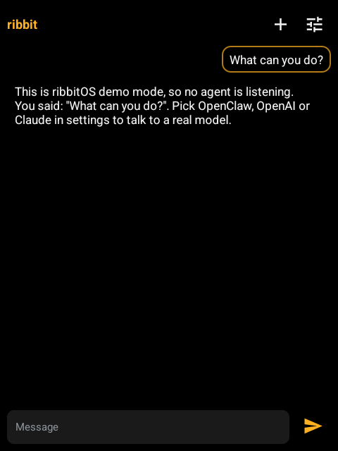
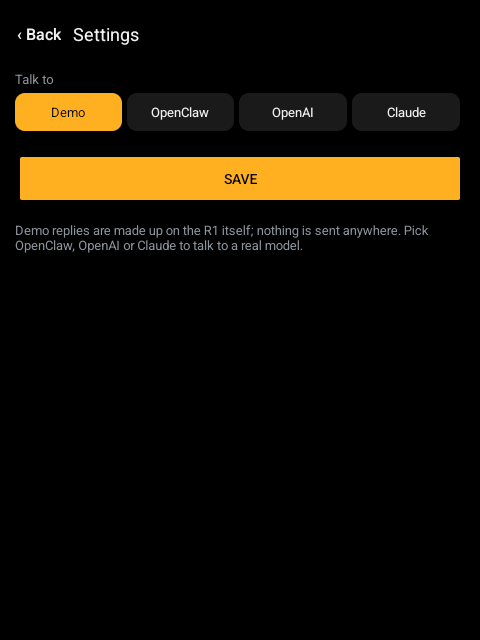
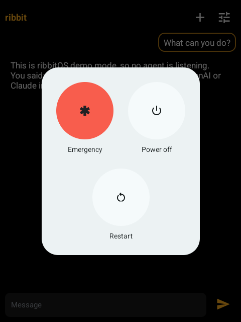

# RibbitOS 🐸

**A free, open-source replacement for rabbitOS on the Rabbit R1.**

A FOSS operating system for your R1, talking to your own [OpenClaw](https://docs.openclaw.ai) agent, OpenAI,
or Claude. No OS3 account or third party cloud, and it's MIT-licensed!

<p>
  
  
  
</p>

> **v0.01-alpha.** Text chat works end to end! Voice typing, sending a photo from the
> camera, and a lock screen are next. We are not yet accepting contributions (though maybe soon. Open a pull request!)

## Features

- **Model-agnostic:** OpenClaw (self-hosted agent), OpenAI (or any server that speaks its Chat
  Completions API), Claude, or a built-in demo that needs no server at all.
- **Customized for smaller sreen:** one conversation, replies stream in as they're written, a stop
  button, the scroll wheel scrolls, full screen with nothing else in the way.
- **Keys Kept local** Set them on the device, or push them from a computer over USB so
  nobody types an API key on a tiny keyboard.
- **Easy extensibility** one small `Backend` interface. Adding a provider doesn't touch the screens.

## RibbitOS Lite vs. RibbitOS

If you would like a more fully featured, complete option with a more polished UI and functionality, use RabbitOS (coming soon.)

RibbitOS lite is built to be a dead simple integration of the R1's functionality while giving access to cloud models.
The goal with lite was to create a platform to make your own apps and integrations off of!

## Install

You need an R1, a computer with `adb`/`fastboot`, and about an hour. **Unlocking voids the R1's
warranty, and a bad flash can permanently destroy it. We are not responsible for any broken devices, USE AT YOUR OWN RISK.**

1. In rabbit's OS3: **settings → r1 →** developer mode, then **device modification → unlock**.
2. Back up the R1: `tools/backup.sh` (needs [mtkclient](https://github.com/bkerler/mtkclient)).
3. Get into fastboot ([docs/FASTBOOT.md](docs/FASTBOOT.md)), then `fastboot flashing unlock`.
4. Flash LineageOS 21 ([Andy Yan's](https://sourceforge.net/projects/andyyan-gsi/files/lineage-21-pre-qpr2-td/)
   `arm64_bvN` GSI): `tools/flash-gsi.sh <gsi.img> <unzipped stock rabbitOS v0.8.293>`.
5. In LineageOS's first-boot setup, turn on **Settings → System → Developer options → USB
   debugging** (tap *About phone → Build number* 7 times first). That is the only time you use
   Android's own setup.
6. Set the R1 up as ribbitOS from your computer (installs the app as the home screen, hides the
   navigation bar and Android's lock screen, marks setup done so it never returns, and switches off
   the other apps; everything it changes is listed in the script):
   ```sh
   tools/provision.sh ribbitos-lite.apk my-r1.env   # my-r1.env: see tools/r1.example.env
   ```

## Build

JDK 17 and the Android SDK (platform 35):

```sh
./gradlew check assembleRelease
```

## Credits

Built on [robotOS](https://github.com/windoze95/robotOS) (MIT), r1_escape, TurboTheTurtle's R1 notes,
Andy Yan's LineageOS GSIs, and rabbit's developer program. Details in [NOTICE](NOTICE).
Not affiliated with Rabbit Inc., OpenAI, Anthropic or OpenClaw.

MIT License.
